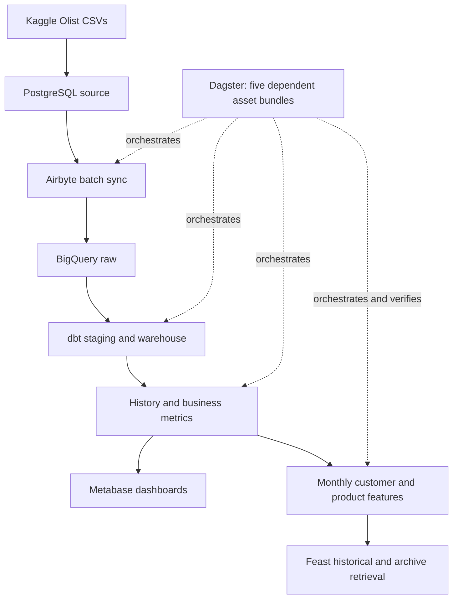

# Retail analytics warehouse and ML feature platform

Nexvia Technologies DE-04 project: historical Olist data moves from PostgreSQL through Airbyte into BigQuery, where dbt builds a tested warehouse, shared metrics, and monthly customer/product features. Dagster coordinates five stages. Metabase presents business insights. Feast verifies historical retrieval and an explicitly archival online lookup.

**Deployment status:** working local/cloud hybrid, with BigQuery in Google Cloud. This repository is source publication, not an always-on hosted service. No trained prediction model or real-time streaming is claimed.

## Architecture



## Implemented scope

| Area | Implementation |
|---|---|
| Source | Nine historical CSV tables; 99,441 orders within 1,550,922 total source rows |
| Ingestion | Airbyte PostgreSQL to BigQuery; Full Refresh/Overwrite, triggered by Dagster |
| Warehouse | Order-item fact with customer, product, seller/store, and date dimensions |
| History | Type 2 customer location observations and temporal fact matching |
| Metrics | Delivered item sales, orders, AOV, repeat buyer rate; margin explicitly unavailable |
| Dashboards | Sales Overview and Marketplace Breakdown; ten custom questions |
| Features | Seven customer and seven product features at monthly cutoffs |
| Feature store | BigQuery offline; local registry/SQLite archive online demonstration |
| Reliability | SQL tests, mocked Airbyte monitoring/retry tests, feature comparison tests, per-run evidence |

Observed customer/product verification report dated 16 November 2026 passed for both entities: **905,254 customer snapshots / 95,420 customers**, and **341,831 product snapshots / 32,951 products**; 25 monthly cutoffs each. These are historical observations, not assertions for changed source data. Identifiers, raw sample records, keys, and runtime databases are excluded from this repository.

## Start here

1. Read [setup](docs/SETUP.md) for prerequisites, credentials, and exact execution commands.
2. Read [model and metric definitions](docs/MODELS_AND_METRICS.md) before interpreting results.
3. Read [free deployment options](docs/DEPLOYMENT.md) before choosing hosting.
4. Use the [Nexvia acceptance checklist](docs/NEXVIA_ACCEPTANCE.md) and [demo guide](docs/DEMO.md) for submission.

The Windows setup helper installs three separate Python 3.11 environments; it does not create cloud resources or start ingestion:

```powershell
.\scripts\setup-environments.ps1
```

Your existing working installation is separate from this published checkout. Configure this checkout before running it; your current local database and services are not modified by publishing code.

## Limits

- Historical batch data from 2016-2018; no CDC, Kafka, or continuous streaming.
- Customer history reflects order-associated observations, not audited change timestamps.
- ML windows approximate event-time availability; Olist lacks field-level availability logs.
- Archive online views preserve 2018 timestamps and are not fresh prediction features.
- No product costs: no fabricated profit/margin. Shared metric tables are not a deployed formal semantic engine.
- BigQuery sandbox expiration and usage limits still apply, including to unpartitioned tables.
- Local schedules require the laptop, services, internet, and valid credentials to remain available.

## Data attribution

Source: [Brazilian E-Commerce Public Dataset by Olist](https://www.kaggle.com/datasets/olistbr/brazilian-ecommerce). Obtain the files from Kaggle and comply with the dataset's license and attribution requirements. Source records are not redistributed here.
